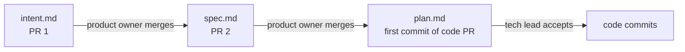

# Stages

Each stage ends with an output in git or CI. Stage 1 sets a risk tier (T1, T2, T3),
and the tier decides how much of stages 2 to 6 a change goes through
([risk-tiers.md](risk-tiers.md)). Stage 7 feeds new intents back to stage 1.

## Roles
Assume every role exists, even when one person holds them all.

| Role | Does |
| --- | --- |
| Product owner | Accepts the intent and the spec. Consults the tech lead on a T3 spec. |
| Tech lead | Accepts a T3 plan. Owns `REVIEW.md` and tunes it monthly. |
| Engineer | Writes the plan and the code. Accepts a T2 plan. |
| Owner | Approves T3 merges and process removals, and decides after two review rounds. CI reads it from `ADLC_OWNER`. |

## T3 change folder
Each T3 change gets one folder, `intent/YYYY-MM-DD-<slug>/`, with three files.
Each file is accepted in order, and each acceptance starts the next step.
Templates: `templates/intent/` in the ADLC repo.

The folder stays after merging, as the record of the change.
Older single-file specs in `docs/specs/` stay where they are.

## 1 Plan
- Write the intent: what is wanted, why, constraints, open questions, and when it is done.
  "Done" names the check that proves it: a test, a command or a page to load.
- T1: one line in the PR. T2: an issue. T3: `intent.md` in the change folder, merged in its own PR.
- Set the tier with `scripts/adlc.py tier` on the planned files. A person may raise a tier, never lower it.

## 2 Design (T2, T3)
- The spec lists the acceptance tests to add and the files in scope.
- A T3 spec is `spec.md` in the change folder, merged in its own PR after the intent.
  It adds a short Decision section (choice, alternatives, why).
  There are no separate architecture decision records.
- Results are not written in the spec. Tests and CI produce them.
- Repos with a UI may keep a `DESIGN.md`; CI lints it. See [design-md.md](design-md.md).

## 3 Build
- T2 and T3 start from an accepted plan (plan mode in Claude Code, or a written plan in any tool).
- A T3 plan is `plan.md` in the change folder, the first commit of the code PR.
  The tech lead accepts it before any code is pushed.
  When the work departs from the plan, update `plan.md` in the same commit.
- The pre-commit hook scans the staged diff for secrets, then formats, lints and type-checks
  staged files only. See [formatting.md](formatting.md) and [secrets.md](secrets.md).
- Tool versions come from committed version files and lockfiles. See [toolchain.md](toolchain.md).
- No pre-push hook.
- The PR title is a Conventional Commit; PRs are squash-merged. See [commits-and-releases.md](commits-and-releases.md).

## 4 Verify
- CI runs the fast check and secret scan on the PR's changes, and the full test suite once per change.
- T3: commit a failing test before the fix; the fix must not edit that test. List the test in
  `.adlc/protected` in the same commit; CI fails any later commit that edits it.
- T3: re-run only the proof records whose input hash changed. Full re-proof runs on a schedule.
- A fix for a flaky test runs that one test many times, on the base and on the branch.
  The base must fail at least once and the branch never. This is the one repeated run.

## 5 Review
- One agent review per PR against `REVIEW.md`. See [review-budget.md](review-budget.md).

## 6 Release
- T1, T2: merge when CI and review pass.
- T3: the owner approves ([how](risk-tiers.md#t3-approval)). Where the repo deploys, use a feature flag or staged rollout and a tested rollback.
- Repos that ship releases: SemVer version, Common Changelog entry written at release time, tag `vX.Y.Z`.
  See [commits-and-releases.md](commits-and-releases.md).
- Where the repo deploys on a push to main, watch the deploy run until it ends.
  If it fails, tell the owner at once and name the failed step.

## 7 Operate
- Monitors, scheduled scans and incidents open issues that start at stage 1.
- A scheduled check that cannot run reports a failure. It never reports zero findings.
- A scheduled agent gets read-only tokens wherever it only reads.
- An agent that reads issues, PRs or comments from people outside the repo may only comment.
  It never pushes, merges or changes settings.
- Dependabot opens weekly version updates, and security updates outside that schedule. See [toolchain.md](toolchain.md).
- Each ADLC release opens a sync PR in every repo behind it. See [sync.md](sync.md).
- Each incident adds a regression test or eval.

## 8 Retire
- Monthly, when `AGENTS.md` passes 60 lines, and when the main AI model changes. See [retire.md](retire.md).
