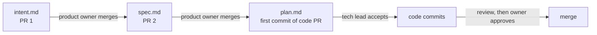

# Spec: separate intent, spec and plan files

Date: 2026-10-23. Intent: [intent.md](intent.md). Tier: T3.

## Tests to add
None. The change is to docs, skills and Markdown templates, which no test reads.
The existing suite, `bash tests/run.sh`, must still pass.

## Files in scope
- `templates/spec.md`, split into `templates/intent/intent.md`, `templates/intent/spec.md` and `templates/intent/plan.md`
- `templates/REVIEW.md`
- `skills/adlc-plan/SKILL.md`, `skills/adlc-spec/SKILL.md`, `skills/adlc-review/SKILL.md`, `skills/adlc-retire/SKILL.md`
- `docs/stages.md`, `docs/risk-tiers.md`, `docs/retire.md`
- `AGENTS.md` (layout line for `intent/`)
- `intent/2026-10-23-separate-intent-spec-plan/` (this folder)

## Out of scope
- A CI check for the hand-off order or the plan acceptance.
- Updating `REVIEW.md` in repos that already have one.
- Moving old specs out of `docs/specs/`.
- Changes to T1 and T2.
- HTML views of these files.

## Diagram

## Decision
- Choice: one folder per T3 change, `intent/YYYY-MM-DD-<slug>/`, holding `intent.md`, `spec.md` and
  `plan.md`. Each file is accepted in order. One `REVIEW.md` per repo, owned by the tech lead.
- Alternatives: one combined spec file (the current rule); HTML files; separate `intent/`, `specs/`
  and `plans/` folders; the folder under `docs/specs/`.
- Why: the playbook gives each file its own approver, and it commits `spec.md` next to `intent.md`.
  Its measures read git timestamps per file, which a combined file hides.
  GitHub renders Markdown in files and PR diffs, but it does not render HTML
  ([GitHub docs](https://docs.github.com/en/repositories/working-with-files/using-files/working-with-non-code-files)).
  The playbook names the folder `intent/`, and Anand chose that name.
  The playbook names no place for `plan.md`. Keeping it in the same folder keeps the chain together.
- Bootstrap: this PR adds the rule, so its own intent and spec could not merge before the code.
  Anand chose the layout and the `REVIEW.md` changes in the project thread on 2026-10-23,
  and asked for one PR.
