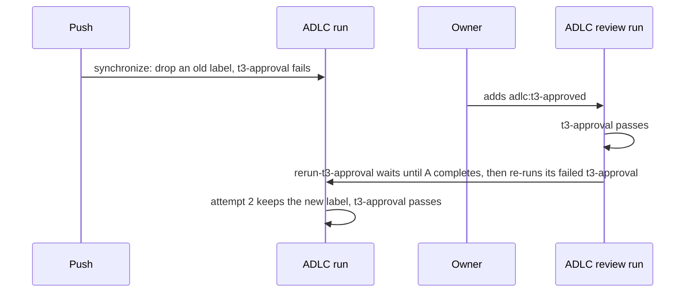

# Spec: T3 approval passes after the owner approves, with no re-run

Date: 2026-10-23. Intent: [intent.md](intent.md). Tier: T3.

## Tests to add
All in `tests/test_adlc.py`. Each new test fails on `main` today. The tests run the shell scripts of the
workflow steps, as the `Drift` tests do, with a fake `gh` on `PATH` that serves fixed JSON and logs each request.

- `test_drop_step_keeps_a_label_added_after_the_head_commit`: the script of the step "Drop the T3 approval
  label after a new commit" sends no `DELETE` when the last change to `adlc:t3-approved` is a `labeled`
  after the head commit reached GitHub, at attempt 1 and at attempt 2. It sends one `DELETE` when that
  `labeled` is older than the head commit.
- `test_approval_re_runs_the_failed_approval_jobs_of_earlier_runs`: the script of the new job
  `rerun-t3-approval` re-runs each failed `t3-approval` job of a completed earlier `ADLC` or `ADLC review`
  run on the head commit. It never re-runs a `checks` job, a passed job, the current run, or a run of another workflow.
- `test_approval_re_run_skips_a_run_of_another_release`: a run whose ADLC workflow commit
  (`referenced_workflows[].sha`) differs from the current run's is not re-run. The script fails and
  names that run and the step that clears it.
- `test_approval_re_run_waits_only_for_a_failed_or_running_approval`: the script waits while an earlier
  `t3-approval` job is running, or failed in a run that is still running. It re-runs that job once the run
  completes. It does not wait for a run whose `t3-approval` passed. When the wait ends first, the script fails and names the run.
- `test_approval_re_run_counts_a_job_already_running_again`: when the re-run request fails and the run
  is queued or running again, the script passes. When the run is neither, the script fails.
- `test_approval_re_run_stops_when_the_head_moved`: when the PR's head is not the head of the event,
  the script re-runs nothing.
- `test_only_the_re_run_job_can_write_actions`: `rerun-t3-approval` needs `t3-approval`, and runs only when
  that job passed on a T3 PR at attempt 1. Its permissions are `actions: write`, `contents: read` and
  `pull-requests: read`, and no other job has `actions`. It has one concurrency group per PR, and no checkout step.
  The `adlc-review.yml` caller template grants `actions: write`, and the `adlc.yml` caller template does not.
- Change `test_review_runs_only_review_jobs`: `adlc-review.yml` has the jobs `t3-approval`, `review-budget`
  and `rerun-t3-approval`.

The existing tests of `t3_approval` keep the gate shut: a label older than the head commit,
or by another account, and an approval of another commit, all fail it.

## Files in scope
- `.github/workflows/adlc.yml`: the drop step, the comments, the manifest (`adlc.py manifest --write`).
- `.github/workflows/adlc-review.yml`: the same `t3-approval` job, the new job, the comments.
- `templates/github/workflows/adlc-review.yml`: `actions: write`, the comments.
- `tests/test_adlc.py`.
- `docs/risk-tiers.md` (T3 approval) and `docs/sync.md` (the jobs of `adlc-review.yml`, and the step for a
  T3 PR whose `ADLC` run is from the release before).
- `intent/2026-10-23-t3-approval-after-label/` (this folder).

## Out of scope
- Re-running `checks`, or any job other than `t3-approval`.
- Fork PRs. `t3-approval` cannot pass on a fork PR today, because its labeling step needs write access. This change does not alter that.
- The docs of the repos on the ADLC, such as the stale-run note in the portfolio runbook. Each repo updates its own.
- The pre-existing gap that `t3-approval` runs the PR's own copy of `.adlc/scripts/adlc.py`.

## Diagram

## Decision
- Choice:
  1. The drop step removes the label only when its last `labeled` is older than the head commit.
     It uses the same `since` as the approval step: when the commit's first check suite was created.
  2. A new job in `adlc-review.yml`, `rerun-t3-approval`. It runs after `t3-approval` passes on a T3 PR, at attempt 1 only.
     It waits while an earlier `t3-approval` on the head commit is running, or failed in a run that is still running, up to 30 minutes.
     Then it re-runs each failed `t3-approval` job of the earlier `ADLC` and `ADLC review` runs on that commit
     that use the same ADLC commit as the current run.
     It calls only the GitHub API, inline in the shared workflow, and runs no file from the PR.
     It alone gets `actions: write`, which the caller `adlc-review.yml` grants.
     One concurrency group per PR runs one such job at a time.
  3. `docs/sync.md` gives the step for a T3 PR whose `ADLC` run is from the release before:
     after the approval, move the PR to draft and back. The new `ADLC` run then uses the new release.
- Alternatives:
  - One workflow runs `t3-approval` on every PR event. This relies on GitHub's rule for picking among checks
    of one name, which I don't know and which no doc I found states. A review event may still keep its own result.
  - `adlc.yml` also runs on label and review events. Its `checks` job would then either run the full suite
    again, or be skipped, and a skipped job replaces a failed result (intent, constraint 3).
  - A `workflow_run` caller re-runs `t3-approval` when an `ADLC` run completes. That adds a third caller,
    and it runs from the default branch, for the result that the wait gives.
  - The drop step skips only re-runs (`GITHUB_RUN_ATTEMPT` is not 1). It still removes a label that the
    owner adds between a push and the drop step, so the PR stays blocked.
  - The new job re-runs runs of the release before too. A re-run of a job uses the reusable workflow
    from the commit of the first attempt, so the old drop step would remove the label again.
  - The docs tell the owner or an agent to re-run the job. The intent says no one re-runs a job.
- Why:
  - A re-run turns each earlier result green, whatever rule GitHub uses among checks of one name.
  - The REST docs do not say whether a job of a run in progress can be re-run, so the job waits until that run completes.
    A failed `t3-approval` in an `ADLC` run waits for its `checks` job, which can take 10 minutes.
    The job never waits for a run whose `t3-approval` passed, so two `ADLC review` runs never wait on each other.
  - The `GITHUB_TOKEN` is a GitHub App installation access token
    ([GitHub docs](https://docs.github.com/en/actions/concepts/security/github_token)).
    Such a token needs Actions write to "Re-run a job and its dependent jobs in a workflow run"
    ([GitHub docs](https://docs.github.com/en/rest/actions/workflow-runs#re-run-a-job-from-a-workflow-run)).
    A job-level `permissions` block sets each scope it does not name to none, so the job also names
    the reads it needs. The trial in "Done when" proves the whole path.
  - A re-run of one job uses the reusable workflow from the commit of the first attempt
    ([GitHub docs](https://docs.github.com/en/enterprise-server@3.8/actions/managing-workflow-runs/re-running-workflows-and-jobs)).
    So the job compares `referenced_workflows[].sha` of each run with its own.
  - The attempt check stops a chain: re-running a job also re-runs the jobs that need it, and those see attempt 2.
  - When two approval events come at once, the concurrency group queues the second job, and GitHub cancels
    a queued one when a newer one arrives. If a re-run request still fails, the script reads the run again.
- Cost: on a T3 PR, each label or review event adds one job, which GitHub bills as at least one minute in a private repo.
  The job waits only in the case above.
- The trial: the first T3 sync PR of the new release, in a repo on it.
  1. Before the label, the PR's `adlc / t3-approval` fails, and `gh pr merge` is refused.
  2. The owner adds the label. The PR then merges with no re-run and no draft toggle.
  3. A re-run of the earlier `ADLC` run keeps the label and passes.

  No repo has a second account that could add a label, or a T3 PR opened by another account.
  So the unit tests of `t3_approval` alone cover a label from another account and the review path.
