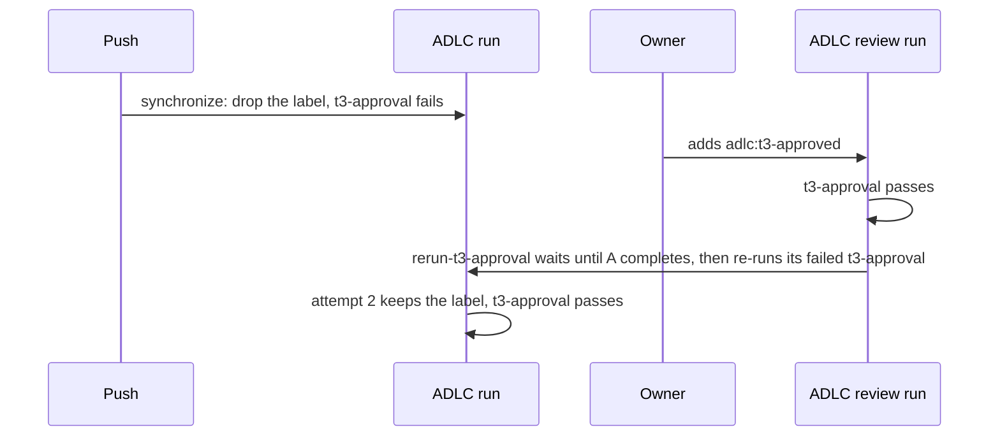

# Spec: T3 approval passes after the owner approves, with no re-run

Date: 2026-10-23. Intent: [intent.md](intent.md). Tier: T3.

## Tests to add
All in `tests/test_adlc.py`. Each new test fails on `main` today. The tests run the shell scripts of the
workflow steps, as the `Drift` tests do, with a fake `gh` on `PATH` that serves fixed JSON and logs each request.

- `test_a_re_run_keeps_the_label`: the script of the step "Drop the T3 approval label after a new commit"
  sends no request when `GITHUB_RUN_ATTEMPT` is 2. When it is 1, it sends one `DELETE` of `adlc:t3-approved`.
- `test_approval_re_runs_the_failed_approval_jobs_of_earlier_runs`: the script of the new job
  `rerun-t3-approval` re-runs each failed `t3-approval` job of a completed earlier `ADLC` or `ADLC review`
  run on the head commit. It never re-runs a `checks` job, a passed job, the current run, or a run of another workflow.
- `test_approval_re_run_waits_for_an_adlc_run_in_progress`: an `ADLC` run that is in progress at the first
  poll and completed with a failed `t3-approval` at the second gets re-run. When the wait ends first,
  the script fails and names that run.
- `test_approval_re_run_stops_when_the_head_moved`: when the PR's head is not the head of the event,
  the script re-runs nothing.
- `test_only_the_re_run_job_can_write_actions`: `rerun-t3-approval` needs `t3-approval`, and runs only when
  that job passed on a T3 PR at attempt 1. Only it has `actions: write`, and it has no checkout step.
  The `adlc-review.yml` caller template grants `actions: write`, and the `adlc.yml` caller template does not.
- Change `test_review_runs_only_review_jobs`: `adlc-review.yml` has the jobs `t3-approval`, `review-budget`
  and `rerun-t3-approval`.

The existing tests of `t3_approval` keep the gate shut: a label older than the head commit,
or by another account, and an approval of another commit, all fail it.

## Files in scope
- `.github/workflows/adlc.yml`: the drop step, the comments, the manifest (`adlc.py manifest --write`).
- `.github/workflows/adlc-review.yml`: the same `t3-approval` job, the new job, the comments.
- `templates/github/workflows/adlc-review.yml`: `actions: write`, the comments.
- `tests/test_adlc.py`.
- `docs/risk-tiers.md` (T3 approval) and `docs/sync.md` (the jobs of `adlc-review.yml`).
- `intent/2026-10-23-t3-approval-after-label/` (this folder).

## Out of scope
- Re-running `checks`, or any job other than `t3-approval`.
- Fork PRs: their token can only read, so the new job fails there, and the owner re-runs the job by hand.
- The docs of the repos on the ADLC, such as the stale-run note in the portfolio runbook. Each repo updates its own.
- The pre-existing gap that `t3-approval` runs the PR's own copy of `.adlc/scripts/adlc.py`.

## Diagram

## Decision
- Choice:
  1. The drop step's script exits with no request when `GITHUB_RUN_ATTEMPT` is not 1.
  2. A new job in `adlc-review.yml`, `rerun-t3-approval`. It runs after `t3-approval` passes on a T3 PR, at attempt 1 only.
     It waits up to 30 minutes for the `ADLC` runs on the head commit to complete.
     Then it re-runs each failed `t3-approval` job of the earlier `ADLC` and `ADLC review` runs on that commit.
     It calls only the GitHub API, inline in the shared workflow, and runs no file from the PR.
     It alone gets `actions: write`, which the caller `adlc-review.yml` grants.
- Alternatives:
  - One workflow runs `t3-approval` on every PR event. This relies on GitHub's rule for picking among checks
    of one name, which I don't know and which no doc I found states. A review event may still keep its own result.
  - `adlc.yml` also runs on label and review events. Its `checks` job would then either run the full suite
    again, or be skipped, and a skipped job replaces a failed result (intent, constraint 3).
  - A `workflow_run` caller re-runs `t3-approval` when an `ADLC` run completes. That adds a third caller,
    and it runs from the default branch, for the result that the wait gives.
  - The drop step removes only a label older than the head commit. The approval step already ignores
    such a label, so the attempt check gives the same outcome with less code.
  - The docs tell the owner or an agent to re-run the job. The intent says no one re-runs a job.
- Why: a re-run turns each earlier result green, whatever rule GitHub uses among checks of one name.
  The REST docs do not say whether a job of a run in progress can be re-run, so the job waits until
  the `ADLC` run completes. Its `checks` job can take 10 minutes. It does not wait for `ADLC review` runs, so two of them never wait on each other.
  The REST docs say a GitHub App needs `actions:write` to re-run a job
  ([GitHub docs](https://docs.github.com/en/enterprise-server@3.7/rest/actions/workflow-runs)).
  No doc I found says that the `GITHUB_TOKEN` can, so the trial in "Done when" proves it.
  The attempt check stops a chain: re-running a job also re-runs the jobs that need it, and those see attempt 2.
- The trial: the first T3 sync PR of the new release, in a repo on it. The owner labels it after its `ADLC` run fails.
  No repo has a T3 PR opened by another account, so the unit tests alone cover the review path.
