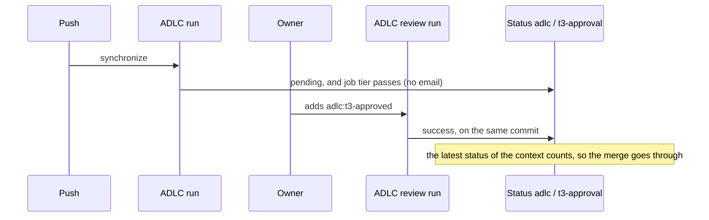

# Spec: T3 approval waits for the owner without a failed run

Date: 2026-10-24. Intent: [intent.md](intent.md). Tier: T3.

## Tests to add
All in `tests/test_adlc.py`. Each new test fails on `main` today. The step tests run the shell script of a
workflow step with the fake `gh` of the `DropStep` tests, which serves fixed JSON and logs each request.

- `test_t3_status_reports_each_tier`: `adlc.py t3-status` prints one JSON object with `state` and `description`, and exits 0.
  T1 and T2 give `success` and read no file. A T3 change gives `success` when `t3_approval` approves, and `pending` otherwise.
  Each `description` has at most 140 characters. The GitHub docs give no limit. Two other tools that post statuses
  cut the description to 140 characters ([ofborg](https://git.lix.systems/the-distro/ofborg/commit/5730914971c1f5e660aa1b3e7d4ccf5db2f36e76),
  [Zuul](https://opendev.org/zuul/zuul/commit/fb6cc99768104e40bc3c709dfe8a0c8ad09e6123)). These are secondary sources.
- `test_t3_status_fails_on_a_bad_file`: an events file that is not JSON makes `t3-status` exit with an error, not print `pending`.
- `test_waiting_t3_pr_posts_pending_and_passes`: the step "Report the owner's approval" posts one status on the head commit,
  with context `adlc / t3-approval`, state `pending` and a `target_url` of the run. The step exits 0.
- `test_approved_t3_pr_posts_success`: with the owner's label after the head commit, the step posts `success`.
- `test_t1_and_t2_post_success_without_reading_the_pr`: for T1 and T2, the step posts `success` and sends no request for reviews or events.
- `test_status_follows_an_approval_during_the_step`: when the label shows up between two reads, the step posts `pending`
  and then `success`, and exits 0.
- `test_status_step_fails_when_the_approval_keeps_changing`: when each of 5 reads gives a new answer, the step exits 1.
- `test_failed_job_posts_a_failed_status`: the script of the step "Block the merge when this job fails" posts `failure` under `adlc / t3-approval`.
- `test_tier_job_runs_no_file_from_the_pr`: the job `tier` checks out the ADLC at `job.workflow_repository` and `job.workflow_sha`,
  and runs `adlc.py` only from that copy, with `python3 -I`. It checks out the PR with `persist-credentials: false`,
  and no step runs a file of the PR's checkout.
- `test_dependabot_prs_need_no_owner_approval`: the step of `adlc-dependabot.yml` posts `success` under `adlc / t3-approval`
  on the PR's head commit, before its tier step, so a Dependabot PR passes as today.
- `test_tier_job_is_the_same_in_both_workflows_and_never_needs_approval_to_pass`: replaces
  `test_t3_approval_is_the_same_in_both_workflows_and_fails_when_the_tier_fails`. The job `tier` is the same in
  `adlc.yml` and `adlc-review.yml`. It runs `adlc.py tier --explain` and `adlc.py t3-status` of the ADLC's copy, has no `needs` and no `continue-on-error`.
  Its last step runs on `failure() || cancelled()`.
- `test_review_runs_only_review_jobs`: changed. `adlc-review.yml` has the jobs `tier` and `review-budget`. `adlc.yml` has `tier` and `checks`.
- `test_only_the_tier_jobs_write_statuses`: replaces `test_only_the_re_run_job_can_write_actions`. No job has `actions: write`.
  Only `tier` in `adlc.yml` and `adlc-review.yml`, and `tier` in `adlc-dependabot.yml`, have `statuses: write`.
  The callers `adlc.yml` and `adlc-review.yml` grant `actions: read` and `statuses: write`. The caller `adlc-dependabot.yml` grants `statuses: write`.
- `test_one_status_name_everywhere`: the three shared workflows post only the context `adlc / t3-approval`,
  and each caller template names its job `adlc`, so the required check of each repo keeps its name.

The tests of the class `RerunStep` go, with the job they test.
The tests of `t3_approval` stay as they are, and keep the gate shut: a label older than the head commit,
or by another account, and an approval of another commit, all fail it.

## Files in scope
- `.github/workflows/adlc.yml` and `adlc-review.yml`: the job `tier`, which runs the ADLC's own `adlc.py`, the comments,
  the manifest (`adlc.py manifest --write`).
  `adlc-review.yml` loses `rerun-t3-approval`.
- `.github/workflows/adlc-dependabot.yml`: the status step, `statuses: write`.
- `templates/github/workflows/adlc.yml`, `adlc-review.yml` and `adlc-dependabot.yml`: the permissions and the comments.
- `scripts/adlc.py`: the command `t3-status` in place of `t3-approved`. The function `t3_approval` does not change.
- `tests/test_adlc.py`.
- `docs/risk-tiers.md` (T3 approval) and `docs/sync.md` (the jobs, and a T3 PR open across a sync).
- `skills/adlc-release/SKILL.md`: `t3-approval` is a status that stays pending until the approval.
  Before it merges a T3 PR, the agent checks the owner's approval itself (Decision, item 9).
- `intent/2026-10-24-t3-approval-without-failed-runs/` (this folder).

## Out of scope
- The settings of each repo. The required check keeps its name `adlc / t3-approval`, so no repo changes its required checks.
- The repo-owned files of each repo that name `rerun-t3-approval` or the draft toggle, such as an AGENTS.md or a merge skill.
  Each sync PR updates its own, as the changelog's Breaking line asks.
- The owner's notification settings, and failure emails from other workflows.
- Fork PRs. The labeling step needs write access, as today.
- Two gaps that the review of this spec found, which are there today and stay:
  - A PR can pass its own required checks by changing its caller `.github/workflows/adlc.yml` to call another workflow
    with jobs of the same names. A `pull_request` run uses the PR's copy of the caller.
  - A Dependabot PR with commits by others passes `adlc / t3-approval`, as the skipped job does today.

## Diagram

## Decision
- Choice:
  1. The job `t3-approval` becomes `tier`. It still finds the tier, labels the PR and drops a label older than the run.
     It no longer fails when the owner has not approved. It runs no file from the PR, because it can write statuses.
     It checks out the PR only to list the changed files and read `.adlc/tiers`, with `persist-credentials: false`.
     It runs `adlc.py` from the ADLC itself, checked out at `job.workflow_repository` and `job.workflow_sha`
     ([GitHub docs](https://docs.github.com/en/actions/reference/workflows-and-actions/contexts#job-context)),
     the commit of the release the caller pins. The drift step already holds the repo's copy to that file.
     A later step in a job that ran PR code would not be enough: that code can change later steps through `$GITHUB_ENV`,
     `$GITHUB_PATH` or the files on the runner.
  2. Its last step posts the commit status `adlc / t3-approval` on the head commit: `success` for T1 and T2, and for an approved T3 change.
     A T3 change that waits gets `pending`. The run passes, so GitHub sends no failure email.
  3. After each post, the step reads the approval again. It posts again when the answer changed, up to 5 reads, and fails after that.
     So when two runs on one commit overlap, the last status matches the last approval event.
  4. When the job fails or is cancelled, its last step posts `failure`. So an older `success` on the same commit does not stay after
     an error in a job that reaches that step.
  5. `adlc-dependabot.yml` posts `success` for each Dependabot PR. Today the skipped `t3-approval` job counts as a pass, and this keeps that.
  6. `rerun-t3-approval` goes, and the `adlc-review.yml` caller grants `actions: read` in place of `actions: write`.
  7. A T3 PR open across a sync can hold the failed `adlc / t3-approval` check run of the old release.
     `docs/sync.md` says to update its branch from `main` once, before the owner approves. The new commit gets only the status.
     An update after the approval makes a new commit, so the drop step removes the label, and the owner approves again.
  8. `gh pr checks` lists commit statuses, and counts a pending one as pending. Its `--watch` loops while any check is pending,
     and without `--watch` it exits 8 ([gh manual](https://cli.github.com/manual/gh_pr_checks);
     [gh source](https://github.com/cli/cli/blob/trunk/pkg/cmd/pr/checks/aggregate.go)).
     So on a T3 PR that waits, `gh pr checks --watch` runs until the approval.
     The release skill and `docs/risk-tiers.md` say to watch the `ADLC` run with `gh run watch` in its place.
     The changelog's Breaking line names the repo-owned files and agent steps to change: those that wait for
     `adlc / rerun-t3-approval`, toggle draft, or run `gh pr checks`, with or without `--watch`, on a T3 PR before the approval.
     It also names those that read `adlc / t3-approval` as a check run. One is the merge gate of courses,
     `.claude/hooks/bash-gate.mjs`: it needs a check run of that name from the workflow `ADLC` or `ADLC review`.
     With no such check run, it asks the owner before each merge that today needs no question. Its sync PR changes it
     to need the check run `adlc / tier` and a `SUCCESS` status `adlc / t3-approval`, and changes its test in `tools/test-hooks.mjs`.
  9. Any workflow of a repo whose token can write statuses can post `adlc / t3-approval` on any commit of that repo.
     GitHub shows each such post as from GitHub Actions, so the rule's source cannot tell the ADLC's post from another.
     A PR from a branch of the repo runs its own workflows, so an account with push access could open a PR whose workflow
     posts `success` on the head of another T3 PR. A fork PR cannot: GitHub gives it a token that cannot write
     ([GitHub docs](https://docs.github.com/en/actions/reference/workflows-and-actions/workflow-syntax#permissions)),
     unless an admin turns on write tokens for fork PRs of a private repo. No setting closes this.
     The same accounts can already skip the gate of their own PR by changing its caller (Out of scope).
     So the gate stops mistakes, not an account with push access that acts in bad faith, today and after this change.
     The product owner accepts this risk by merging this spec. The guard: before an agent merges a T3 PR, it reads the
     PR's events and checks that the last `adlc:t3-approved` event is `labeled` by the owner after the head commit,
     or that the owner approved the head commit. It does not rely on the green status alone.
- Alternatives:
  - A new status name, such as `adlc / owner-approval`. Each repo would then change its required checks, from the owner's Mac.
  - Keep the job name `t3-approval` next to the status. Then one name shows a passed check and a pending status,
    and readers of `gh pr checks` see both. GitHub requires both to pass, so this would also work.
  - A check run from the Checks API, left open until the approval. It needs `checks: write`,
    and its rule among check runs of one name is the one that release 0.7.0 had to work around.
  - Cancel the run in place of failing it. GitHub notifies about canceled runs too, and the cancel also stops `checks`.
  - A filter in the owner's Gmail, or GitHub settings that send no Actions email. These hide real failures too.
  - A deployment environment with required reviewers. The owner would approve each run on github.com, and the owner works only in chat.
- Why:
  - GitHub sends a notification for a completed run to the user who triggered it, and the user can choose failed runs only
    ([GitHub docs](https://docs.github.com/en/actions/concepts/workflows-and-actions/notifications-for-workflow-runs)).
    The owner's inbox held 91 failure emails in a day and none for passed runs, so the owner gets failed runs only.
    A run that passes sends the owner no email.
  - "Required status checks can be checks or statuses", and all of them must pass before a merge
    ([GitHub docs](https://docs.github.com/en/repositories/configuring-branches-and-merges-in-your-repository/managing-rulesets/available-rules-for-rulesets)).
    A pending status has not passed.
  - "If a check and a commit status have the same name, both must pass when that name is required"
    ([GitHub docs](https://docs.github.com/en/pull-requests/how-tos/merge-and-close-pull-requests/troubleshooting-required-status-checks)).
    So the status meets the required check that each repo has today.
  - For each context, the combined status uses "the latest status"
    ([GitHub docs](https://docs.github.com/en/rest/commits/statuses)). A later `success` replaces the `pending`, with no re-run.
    That removes the re-run job and the draft toggle of release 0.7.0.
  - The `GITHUB_TOKEN` is an installation token of the GitHub App that GitHub Actions installs
    ([GitHub docs](https://docs.github.com/en/actions/concepts/security/github_token)). A label it adds starts no run,
    and a status it posts starts no run.
- Risk: a repo whose rule expects the check from one GitHub App. I don't know if a repo sets that.
  If the trial shows the status does not count, the owner sets the rule's source to GitHub Actions.
  Not to any source: then each account with push access, and each app that can write statuses, could post it.
- Risk: a run that never reaches the job's last step posts nothing, such as a run cancelled while queued or lost with its runner,
  and so does a post of `failure` that fails. The older status of that commit then stays. When the owner has just taken
  the label off, the older `success` stays until the next run on that commit. The guard of item 9 still sees the label gone.
- Cost: one more API call for each post, and one more checkout, of the ADLC, in each run of `tier`.
  One job less on each label or review event of a T3 PR. No runner waits for the owner.
- The trial: the first T3 sync PR of the new release, in a repo on it.
  1. Before the label, the job `tier` passes, the status `adlc / t3-approval` is pending, and `gh pr merge` is refused.
  2. The owner adds the label. The status turns to success, and the PR merges with no re-run and no draft toggle.
  3. The owner's Gmail holds no "run failed" email for the approval of that PR.

  No repo has a second account that could add a label, or a T3 PR opened by another account.
  So the unit tests of `t3_approval` alone cover a label from another account and the review path.
