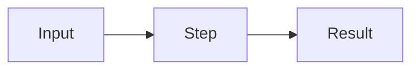

# Spec: <title>

Date: YYYY-MM-DD. Intent: [intent.md](intent.md). Tier: T3.

## Tests to add
- `<test name>`: <what it asserts>

## Files in scope
- `<path>`

## Out of scope
- <what this change will not do>

## Diagram (optional)
A Mermaid diagram when the flow is hard to follow in words. GitHub renders it in Markdown files and PRs.

## Decision
- Choice: <what was chosen>
- Alternatives: <what else was considered>
- Why: <why this one>
